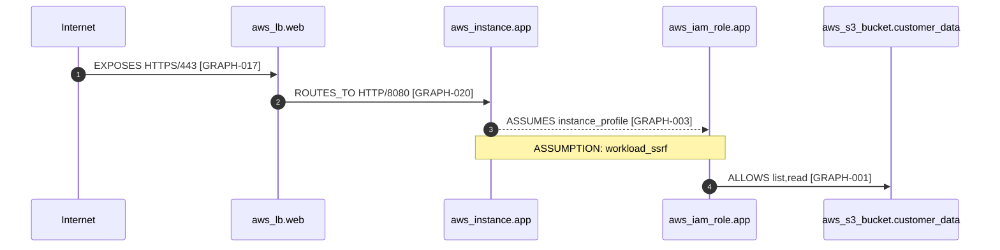

# Security architecture review: 006-public-workload-iam-sensitive-bucket

> Deterministic analysis of the Terraform plan. Paths, edges and priorities come from code, not a model.
> AI annotations, if enabled, appear in their own section and only after passing evidence validation.

| | |
|---|---|
| Resources in plan | 23 (23 modeled) |
| Scanner findings | 40 (Checkov 17 · tfsec 13 · Trivy 10) |
| Findings on attack-path hops | 7 |
| Attack paths | 1 (1 high) |
| PyTM threats, fed with plan evidence | 118: **8 decided by the plan** (5 from the cloud pack) · 110 questions for the app team. Of the architecture-only model's 122, 12 are ruled out |

## In plain words

> What the paths below mean, without threat-modeling vocabulary. Every sentence is built from the same evidence as the tables; nothing here comes from a model.

### PATH-001

**HIGH: Someone on the internet could list and read the customer-data bucket (aws_s3_bucket.customer_data), which holds confidential data, if they find a way to make the app server (aws_instance.app) fetch a web address for them (an SSRF bug) or run code on it.**

How:

1. Anyone on the internet can reach the web load balancer (aws_lb.web) (HTTPS/443). `alb.tf:3`
2. The web load balancer (aws_lb.web) passes those requests on to the app server (aws_instance.app). `network.tf:94-100`
3. The app server (aws_instance.app) can fetch the cloud keys of the app role (aws_iam_role.app) from a local address (IMDS). Because the older IMDS setting is allowed, a request someone tricks the server into making can fetch them too. *(needs the condition above)* `app.tf:10-13`
4. Those keys are allowed to list and read the customer-data bucket (aws_s3_bucket.customer_data) because the permission covers everything of that kind (a wildcard), not only what is needed. `iam.tf:25-35`

**What to change:** Narrow the permission of the app role (aws_iam_role.app) to the resources it actually needs, so it no longer covers the customer-data bucket (aws_s3_bucket.customer_data). A patch for this was re-planned and re-checked: the path disappears (`remediation-PATH-001.diff`). `iam.tf`

**What we need to know from you** (answer in `threat-answers.yaml`):

- Does the customer-data bucket (aws_s3_bucket.customer_data) hold personal data (names, emails, addresses, account or ID numbers)?
- Does the app server (aws_instance.app) check every request's input (type, length, format) before using it?
- Does the web load balancer (aws_lb.web) check every request's input (type, length, format) before using it? (For a load balancer: is a WAF rule doing this in front of the app?)

## PATH-001 · HIGH · plausible

**Internet → aws_lb.web → aws_instance.app → aws_iam_role.app → aws_s3_bucket.customer_data** (confidential asset)

| # | Hop | Status | Evidence |
|---|---|---|---|
| 1 | Internet —EXPOSES(HTTPS/443)→ aws_lb.web | FACT | GRAPH-017; NET-001 `alb.tf:3`, NET-003 `network.tf:72-78` |
| 2 | aws_lb.web —ROUTES_TO(HTTP/8080)→ aws_instance.app | FACT | GRAPH-020; NET-005 `network.tf:94-100` |
| 3 | aws_instance.app —ASSUMES(instance_profile)→ aws_iam_role.app | ASSUMPTION (workload_ssrf) | GRAPH-003; IAM-002 `iam.tf:4-13`, TF-004 `app.tf:10-13` |
| 4 | aws_iam_role.app —ALLOWS(list,read)→ aws_s3_bucket.customer_data | FACT | GRAPH-001; IAM-001 `iam.tf:25-35` |

**Precondition `workload_ssrf`:** Attacker can make the workload issue HTTP requests (SSRF) or execute code (RCE); IMDSv1 is allowed.

This is a *plausible* path assembled from configuration evidence. It does not prove that an exploit exists.

**PyTM threats the plan confirms on this path's hops:**

| Hop | Threat | Element | Decided by |
|---|---|---|---|
| 1 | TAPM-NET-01: Internet-wide ingress to an entry point | `aws_lb.web` | `internetWideIngress = True` (NET-003) |
| 2 | DE03: Sniffing Attacks | `HTTP/8080 (GRAPH-020)` | `isEncrypted = False` (NET-005, TF-005, TF-007, TF-008, TF-009, TF-010) |
| 3 | TAPM-EC2-01: Instance role credentials reachable through SSRF (IMDSv1) | `aws_instance.app` | `hasInstanceRole = True` (GRAPH-006, TF-005); `imdsV1Allowed = True` (TF-004) |
| 3 | TAPM-EC2-02: Internet-reachable workload holds cloud credentials | `aws_instance.app` | `hasInstanceRole = True` (GRAPH-006, TF-005); `internetReachable = True` (GRAPH-020) |
| 4 | DE04: Audit Log Manipulation | `aws_s3_bucket.customer_data` | `implementsPOLP = False` (IAM-001) |
| 4 | TAPM-IAM-01: Workload identity can read or write classified data | `aws_instance.app` | `readsSensitiveData = True` (GRAPH-018) |
| 4 | TAPM-IAM-02: Classified data store reachable through a wildcard-resource grant | `aws_s3_bucket.customer_data` | `readableViaWildcardGrant = True` (IAM-001) |

**Scanner findings on this path's hops** (7 of 40):

| Evidence | Tool | Rule | Severity | Resource | Location |
|---|---|---|---|---|---|
| SCAN-023 | tfsec | `aws-iam-no-policy-wildcards` | high | `aws_iam_role_policy.app_s3` | `iam.tf:26` |
| SCAN-016 | checkov | `CKV_AWS_79` | unrated | `aws_instance.app` | `app.tf:1` |
| SCAN-018 | tfsec | `aws-ec2-enforce-http-token-imds` | high | `aws_instance.app` | `app.tf:12` |
| SCAN-031 | trivy | `AWS-0028` | high | `aws_instance.app` | `app.tf:12` |
| SCAN-022 | tfsec | `aws-elb-alb-not-public` | high | `aws_lb.web` | `alb.tf:3` |
| SCAN-032 | trivy | `AWS-0053` | high | `aws_lb.web` | `alb.tf:3` |
| SCAN-020 | tfsec | `aws-ec2-no-public-ingress-sgr` | critical | `aws_security_group.alb` | `network.tf:77` |

**Remediation options (effect computed by re-running the path engine):**

- Hop 1: Remove internet reachability of aws_lb.web: restrict the 0.0.0.0/0 ingress rule to known client CIDRs or set internal = true (alb.tf:3, network.tf:72-78). *Effect:* breaks this path.
- Hop 3: Require IMDSv2 on aws_instance.app: metadata_options { http_tokens = "required" }. *Effect:* downgrades priority high → medium.
- Hop 4: Scope aws_iam_role.app's policy so it no longer grants list,read on aws_s3_bucket.customer_data (iam.tf:25-35). *Effect:* breaks this path.



## PyTM threat model, fed with plan evidence

`threat-model.py` is plain OWASP pytm. Controls the plan decides are set with the evidence behind them (`pytm-controls.json`); everything else keeps pytm's default and is reported as undecided. pytm's threat library plus a 7-threat cloud pack (`threat-library.json`) then gives:

| | Threats |
|---|---|
| Architecture only (the same model, no evidence-fed controls) | 122 |
| **Decided by the plan**: fire whatever the undecided controls are | **8** |
| Questions for the app team: depend on controls Terraform cannot show | 110 |
| Ruled out by the plan (reported by the architecture-only model) | 12 |

Most-asked undecided controls: `controls.validatesInput` (17 threats) · `controls.sanitizesInput` (12 threats) · `controls.encodesOutput` (9 threats) · `controls.hasAccessControl` (6 threats) · `controls.isEncrypted` (5 threats) · `controls.authorizesSource` (4 threats).

<details><summary>Decided and ruled-out threats, with the evidence</summary>

| Class | Threat | Element | Decided by |
|---|---|---|---|
| confirmed | DE03: Sniffing Attacks | `HTTP/8080 (GRAPH-020)` | `isEncrypted = False` (NET-005, TF-005, TF-007, TF-008, TF-009, TF-010) |
| confirmed | TAPM-EC2-01: Instance role credentials reachable through SSRF (IMDSv1) | `aws_instance.app` | `hasInstanceRole = True` (GRAPH-006, TF-005); `imdsV1Allowed = True` (TF-004) |
| confirmed | TAPM-EC2-02: Internet-reachable workload holds cloud credentials | `aws_instance.app` | `hasInstanceRole = True` (GRAPH-006, TF-005); `internetReachable = True` (GRAPH-020) |
| confirmed | TAPM-IAM-01: Workload identity can read or write classified data | `aws_instance.app` | `readsSensitiveData = True` (GRAPH-018) |
| confirmed | TAPM-NET-01: Internet-wide ingress to an entry point | `aws_lb.web` | `internetWideIngress = True` (NET-003) |
| confirmed | DE04: Audit Log Manipulation | `aws_s3_bucket.customer_data` | `implementsPOLP = False` (IAM-001) |
| confirmed | TAPM-IAM-02: Classified data store reachable through a wildcard-resource grant | `aws_s3_bucket.customer_data` | `readableViaWildcardGrant = True` (IAM-001) |
| confirmed | DE04: Audit Log Manipulation | `aws_s3_bucket.reports` | `implementsPOLP = False` (IAM-001) |
| ruled out | CR08: Client-Server Protocol Manipulation | `HTTPS/443 (GRAPH-017)` | `isEncrypted = True` (TF-007, TF-008); `minTLSVersion = TLSVersion.TLSv12` (TF-007, TF-008); `tlsVersion = TLSVersion.TLSv12` (TF-007, TF-008) |
| ruled out | AC01: Privilege Abuse | `aws_s3_bucket.customer_data` | `authorizesSource = True` (TF-015); `hasAccessControl = True` (TF-015) |
| ruled out | CR05: Encryption Brute Forcing | `aws_s3_bucket.customer_data` | `usesEncryptionAlgorithm = AES` (TF-015, TF-020) |
| ruled out | AC01: Privilege Abuse | `aws_s3_bucket.reports` | `authorizesSource = True` (TF-017); `hasAccessControl = True` (TF-017) |
| ruled out | CR05: Encryption Brute Forcing | `aws_s3_bucket.reports` | `usesEncryptionAlgorithm = AES` (TF-017) |
| ruled out | AC05: Content Spoofing | `role credentials for aws_iam_role.app (GRAPH-003)` | assumption: IMDS is link-local: requests to 169.254.169.254 never leave the host, so network interception does not apply |
| ruled out | CR06: Communication Channel Manipulation | `role credentials for aws_iam_role.app (GRAPH-003)` | assumption: IMDS is link-local: requests to 169.254.169.254 never leave the host, so network interception does not apply |
| ruled out | CR08: Client-Server Protocol Manipulation | `role credentials for aws_iam_role.app (GRAPH-003)` | assumption: IMDS is link-local: requests to 169.254.169.254 never leave the host, so network interception does not apply |
| ruled out | DE01: Interception | `role credentials for aws_iam_role.app (GRAPH-003)` | assumption: IMDS is link-local: requests to 169.254.169.254 never leave the host, so network interception does not apply |
| ruled out | DE03: Sniffing Attacks | `role credentials for aws_iam_role.app (GRAPH-003)` | assumption: IMDS is link-local: requests to 169.254.169.254 never leave the host, so network interception does not apply |
| ruled out | CR06: Communication Channel Manipulation | `s3:GetObject,s3:ListBucket via aws_iam_role.app (GRAPH-018)` | `authorizesSource = True` (IAM-001, IAM-002, TF-001, TF-002, TF-004, TF-005, TF-015); `implementsAuthenticationScheme = True` (IAM-001, IAM-002, TF-001, TF-002, TF-004, TF-005, TF-015) |
| ruled out | CR06: Communication Channel Manipulation | `s3:GetObject,s3:ListBucket via aws_iam_role.app (GRAPH-019)` | `authorizesSource = True` (IAM-001, IAM-002, TF-001, TF-002, TF-004, TF-005, TF-017); `implementsAuthenticationScheme = True` (IAM-001, IAM-002, TF-001, TF-002, TF-004, TF-005, TF-017) |

</details>

## Questions for the app team

pytm has 110 open threats that depend on things Terraform cannot show. These 6 yes/no questions settle 34 of them, whatever the answers are. Answer in `threat-answers.yaml` next to the Terraform; each answer becomes an `APP-###` evidence record and the threat model is re-evaluated. Answers never change an attack path.

| # | Question | Why it matters | Settles |
|---|---|---|---|
| 1 | Does the app server (aws_instance.app) check every request's input (type, length, format) before using it? | Unchecked input is how injection attacks start. | 5 |
| 2 | Does the web load balancer (aws_lb.web) check every request's input (type, length, format) before using it? (For a load balancer: is a WAF rule doing this in front of the app?) | Unchecked input is how injection attacks start. | 5 |
| 3 | Does the app server (aws_instance.app) clean or escape input before it reaches a database, a shell or a template? | Input that reaches a query or a command unescaped can run as code. | 4 |
| 4 | Does the app server (aws_instance.app) encode what it sends back (HTML/JSON escaping), so user data can't become code in a browser? | Unencoded output is how cross-site scripting happens. | 8 |
| 5 | Does the web load balancer (aws_lb.web) clean or escape input before it reaches a database, a shell or a template? (For a load balancer: is a WAF rule doing this in front of the app?) | Input that reaches a query or a command unescaped can run as code. | 4 |
| 6 | Does the web load balancer (aws_lb.web) encode what it sends back (HTML/JSON escaping), so user data can't become code in a browser? (For a load balancer: is a WAF rule doing this in front of the app?) | Unencoded output is how cross-site scripting happens. | 8 |
| · | Does the customer-data bucket (aws_s3_bucket.customer_data) hold personal data (names, emails, addresses, account or ID numbers)? | Personal data raises the stakes of every path to it, and brings legal duties. | informs 1 |
| · | Does the customer-data bucket (aws_s3_bucket.customer_data) hold passwords, keys or tokens? | Stored credentials turn one leak into many. | informs 1 |

## Verified remediation (AI proposes, the pipeline proves)

Patch author: `recorded, fallback simulated`. Each proposal passed a deterministic edit policy, was applied to a copy, re-planned offline and run through the whole pipeline and pytm again. Accepted only if: path gone or downgraded after re-planning; no new path; no resource removed; no new pytm threat decided by the plan. **Nothing was applied to this repository.**

1 of 1 path(s) with a verified fix that breaks them · 0 with a verified downgrade only · 0 proposal(s) rejected

**PATH-001**: proven break

| # | Hop | Proposed change | Result | Why |
|---|---|---|---|---|
| 1 | 3 | `app.tf`: `http_tokens   = "required"` | PROVEN_DOWNGRADE | high → medium; no new paths; pytm resolved TAPM-EC2-01 |
| 2 | 4 | `iam.tf`: `Resource = [aws_s3_bucket.reports.arn, "${aws_s3_bucket.reports.arn}/*"]` | PROVEN_BREAK | path gone after re-planning; no new paths; pytm resolved DE04, TAPM-IAM-01, TAPM-IAM-02 |

Verified patch (`remediation-PATH-001.diff`), for a human to review and apply:

```diff
--- a/iam.tf
+++ b/iam.tf
@@ -29,7 +29,7 @@
         Sid      = "ReadReports"
         Effect   = "Allow"
         Action   = ["s3:GetObject", "s3:ListBucket"]
-        Resource = ["arn:aws:s3:::*"]
+        Resource = [aws_s3_bucket.reports.arn, "${aws_s3_bucket.reports.arn}/*"]
       }
     ]
   })
```

## AI annotations (bounded, evidence-validated)

5 generated · 5 evidence-backed and accepted · 0 rejected · 0 routed to human review · backend `recorded, fallback simulated`, decision layer `local-rules (Jev stand-in, not calibrated)`

- **ANN-001** (attack_path_explanation, PATH-001): PATH-001: aws_lb.web is reachable from the internet (HTTPS/443) [GRAPH-017, NET-001, NET-003]. It forwards traffic to aws_instance.app (HTTP/8080) [GRAPH-020, NET-005]. If aws_instance.app is compromised through an SSRF or code-execution flaw in the workload, because IMDSv1 is allowed, an attacker could obtain the credentials of aws_iam_role.app [GRAPH-003, IAM-002, TF-004]. aws_iam_role.app is allowed s3:GetObject, s3:ListBucket on aws_s3_bucket.customer_data, classified confidential [GRAPH-001, IAM-001]. This is a plausible path, not a proven exploit; it depends on: workload_ssrf [PATH-001].  
  Evidence: GRAPH-001, GRAPH-003, GRAPH-017, GRAPH-020, IAM-001, IAM-002, NET-001, NET-003, NET-005, TF-004
- **ANN-002** (plain_explanation, PATH-001): In plain words: someone on the internet could list and read aws_s3_bucket.customer_data, which holds confidential data [PATH-001]. It only works if the app on aws_instance.app can be tricked into fetching a web address for someone (an SSRF bug) or into running their code [GRAPH-003]. The simplest fix is to let aws_iam_role.app use only what it needs, so it no longer covers aws_s3_bucket.customer_data [GRAPH-001].  
  Evidence: GRAPH-001, GRAPH-003, PATH-001
- **ANN-003** (finding_explanation, PATH-001): The scanners (checkov, tfsec, trivy) report these findings separately; in PATH-001 they line up as hops of one path: SCAN-016 (checkov CKV_AWS_79, unrated) on aws_instance.app is hop 3 [GRAPH-003]; SCAN-018 (tfsec aws-ec2-enforce-http-token-imds, high) on aws_instance.app is hop 3 [GRAPH-003]; SCAN-020 (tfsec aws-ec2-no-public-ingress-sgr, critical) on aws_security_group.alb is hop 1 [GRAPH-017]; SCAN-022 (tfsec aws-elb-alb-not-public, high) on aws_lb.web is hop 1 [GRAPH-017]; SCAN-023 (tfsec aws-iam-no-policy-wildcards, high) on aws_iam_role_policy.app_s3 is hop 4 [GRAPH-001]; SCAN-031 (trivy AWS-0028, high) on aws_instance.app is hop 3 [GRAPH-003]; SCAN-032 (trivy AWS-0053, high) on aws_lb.web is hop 1 [GRAPH-017].  
  Evidence: GRAPH-001, GRAPH-003, GRAPH-017, SCAN-016, SCAN-018, SCAN-020, SCAN-022, SCAN-023, SCAN-031, SCAN-032
- **ANN-004** (remediation, PATH-001): Scope aws_iam_role.app's policy so it no longer grants list,read on aws_s3_bucket.customer_data (iam.tf:25-35) [GRAPH-001, IAM-001]. Re-running the path engine with this change breaks PATH-001.  
  Evidence: GRAPH-001, IAM-001, PATH-001
- **ANN-005** (framework_mapping, PATH-001): PATH-001 maps to CWE-668, T1190, SC-7, CWE-918, T1552.005, CWE-732, AC-6, T1530.  
  Evidence: GRAPH-001, GRAPH-003, GRAPH-017, IAM-001, IAM-002, NET-001, NET-003, TF-004

<details><summary>Scanner findings not on any attack-path hop (33)</summary>

| Evidence | Tool | Rule | Severity | Resource |
|---|---|---|---|---|
| SCAN-001 | checkov | `CKV2_AWS_11` | unrated | `aws_vpc.main` |
| SCAN-002 | checkov | `CKV2_AWS_12` | unrated | `aws_vpc.main` |
| SCAN-003 | checkov | `CKV2_AWS_28` | unrated | `aws_lb.web` |
| SCAN-004 | checkov | `CKV2_AWS_61` | unrated | `aws_s3_bucket.customer_data` |
| SCAN-005 | checkov | `CKV2_AWS_61` | unrated | `aws_s3_bucket.reports` |
| SCAN-006 | checkov | `CKV2_AWS_62` | unrated | `aws_s3_bucket.customer_data` |
| SCAN-007 | checkov | `CKV2_AWS_62` | unrated | `aws_s3_bucket.reports` |
| SCAN-008 | checkov | `CKV_AWS_144` | unrated | `aws_s3_bucket.customer_data` |
| SCAN-009 | checkov | `CKV_AWS_144` | unrated | `aws_s3_bucket.reports` |
| SCAN-010 | checkov | `CKV_AWS_145` | unrated | `aws_s3_bucket.reports` |
| SCAN-011 | checkov | `CKV_AWS_150` | unrated | `aws_lb.web` |
| SCAN-012 | checkov | `CKV_AWS_18` | unrated | `aws_s3_bucket.customer_data` |
| SCAN-013 | checkov | `CKV_AWS_18` | unrated | `aws_s3_bucket.reports` |
| SCAN-014 | checkov | `CKV_AWS_21` | unrated | `aws_s3_bucket.customer_data` |
| SCAN-015 | checkov | `CKV_AWS_21` | unrated | `aws_s3_bucket.reports` |
| SCAN-017 | checkov | `CKV_AWS_91` | unrated | `aws_lb.web` |
| SCAN-019 | tfsec | `aws-ec2-no-public-egress-sgr` | critical | `aws_security_group.app` |
| SCAN-021 | tfsec | `aws-ec2-require-vpc-flow-logs-for-all-vpcs` | medium | `aws_vpc.main` |
| SCAN-024 | tfsec | `aws-s3-enable-bucket-encryption` | high | `aws_s3_bucket.reports` |
| SCAN-025 | tfsec | `aws-s3-enable-bucket-logging` | medium | `aws_s3_bucket.customer_data` |
| SCAN-026 | tfsec | `aws-s3-enable-bucket-logging` | medium | `aws_s3_bucket.reports` |
| SCAN-027 | tfsec | `aws-s3-enable-versioning` | medium | `aws_s3_bucket.customer_data` |
| SCAN-028 | tfsec | `aws-s3-enable-versioning` | medium | `aws_s3_bucket.reports` |
| SCAN-029 | tfsec | `aws-s3-encryption-customer-key` | high | `aws_s3_bucket.reports` |
| SCAN-030 | tfsec | `aws-s3-encryption-customer-key` | high | `aws_s3_bucket_server_side_encryption_configuration.customer_data` |
| SCAN-033 | trivy | `AWS-0089` | low | `aws_s3_bucket.customer_data` |
| SCAN-034 | trivy | `AWS-0089` | low | `aws_s3_bucket.reports` |
| SCAN-035 | trivy | `AWS-0090` | medium | `aws_s3_bucket.customer_data` |
| SCAN-036 | trivy | `AWS-0090` | medium | `aws_s3_bucket.reports` |
| SCAN-037 | trivy | `AWS-0104` | critical | `aws_security_group.app` |
| SCAN-038 | trivy | `AWS-0132` | high | `aws_s3_bucket.reports` |
| SCAN-039 | trivy | `AWS-0132` | high | `aws_s3_bucket_server_side_encryption_configuration.customer_data` |
| SCAN-040 | trivy | `AWS-0178` | medium | `aws_vpc.main` |

</details>

---
Deterministic artifact hashes: graph `7276d576e891` · paths `c34b148447cb` · evidence `147af9d73f59` · PyTM `5f8676721dc4`
